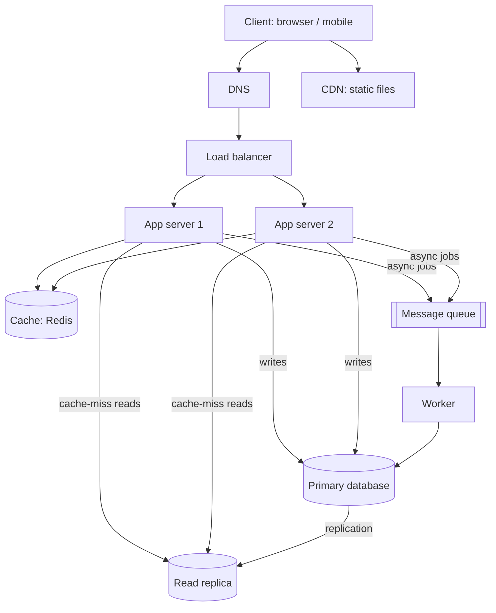

# QuickNotes Architecture

## Requirements

**Functional**

- Register and log in.
- Create, read, update and delete notes.
- Tag notes and filter by tag.
- Search and list notes with pagination.

**Non-functional**

- Availability 99.9% (no single point of failure).
- Low latency: p95 under 200 ms for reads.
- Scalability to 1 million users, growing horizontally.
- Durability: no note lost once acknowledged (replicated backups).
- Security: HTTPS, hashed passwords, per-user authorization.
- Read-heavy workload (about 10 reads for each write).

## Load estimate for 1 million users

Assumptions: 20% daily active users (200,000 DAU), each doing 20 reads and 2 writes per day, peak traffic 3x the average, one note about 1 KB.

| Metric                         | Calculation          | Result                         |
| ------------------------------ | -------------------- | ------------------------------ |
| Reads per day                  | 200,000 x 20         | 4,000,000                      |
| Reads per second (avg / peak)  | 4,000,000 / 86,400   | ~46 / ~140                     |
| Writes per day                 | 200,000 x 2          | 400,000                        |
| Writes per second (avg / peak) | 400,000 / 86,400     | ~5 / ~15                       |
| Storage per year               | 400,000 x 365 x 1 KB | ~146 GB (~220 GB with indexes) |

Conclusion: the load is moderate, so one primary database with a read replica and a cache is enough. We still run multiple app servers for availability, not for raw throughput.

## Architecture diagram

## Components and the problem each one solves

- **Client:** gives the user an interface and sends HTTPS requests to the API.
- **DNS:** turns `api.quicknotes.example` into the load balancer's address so users never need an IP.
- **CDN:** serves static files (HTML, CSS, JS) from locations close to the user, cutting latency and server load.
- **Load balancer:** spreads requests across app servers and removes unhealthy ones, so no server is a bottleneck or single point of failure.
- **App servers (2+):** run the stateless API logic, so we can add or lose servers without losing sessions.
- **Cache (Redis):** keeps hot reads in memory, avoiding repeated database queries and lowering latency.
- **Primary database:** the single source of truth for all writes, with transactions and constraints.
- **Read replica:** takes read traffic off the primary and acts as a standby if the primary fails.
- **Queue:** decouples slow or non-critical tasks from the request so the API responds fast and spikes are absorbed.
- **Worker:** consumes queue jobs (tag indexing, email notifications, cleanup) without blocking users.

## Request flows

### GET /notes

1. Client sends `GET /notes?page=1` with its token over HTTPS.
2. DNS resolves the hostname; the request reaches the load balancer.
3. The load balancer forwards it to a healthy app server.
4. The app server validates the token and reads the user id.
5. It checks the cache with key `notes:{user_id}:page:1`.
6. **Cache hit:** return the cached JSON (step 9).
7. **Cache miss:** query the read replica for the user's notes.
8. Store the result in the cache with a short TTL (60 s).
9. Return `200 OK` with the JSON list.

### POST /notes

1. Client sends `POST /notes` with a JSON body and token.
2. The load balancer forwards it to an app server.
3. The app server validates the token and input (title required, at most 100 characters); invalid input returns `400`.
4. It inserts the note (and tag links) into the primary database in one transaction.
5. It invalidates the user's cached note lists.
6. It publishes a job to the queue (for example, "index note" and "send notification").
7. It returns `201 Created` with the new note and a `Location` header.
8. A worker later picks the job from the queue and processes it in the background.
9. The primary replicates the new row to the read replica.

## Trade-offs

1. **Cache freshness vs. speed.** A 60 s TTL plus invalidation on write keeps reads fast, but a user could briefly see stale data after a write on another device. We accept this because notes are not financial data; strong consistency is available by reading from the primary right after a write.
2. **Read replica lag vs. primary load.** Reading from a replica offloads the primary, but replication is asynchronous, so a just-created note might not appear immediately. We route "read your own write" requests to the primary.
3. **Queue complexity vs. responsiveness.** Async jobs make the API faster and more resilient, but add another system to run and make results eventually consistent.
4. **SQL vs. NoSQL.** We chose SQL for integrity and relationships, accepting harder horizontal write scaling (solved later by sharding on `user_id`).

## Avoiding single points of failure

- **DNS:** a managed provider with multiple name servers.
- **Load balancer:** an active-passive or managed multi-zone pair.
- **App servers:** at least two, in different availability zones, stateless.
- **Cache:** replicated Redis with automatic failover. If it is down the app falls back to the database.
- **Database:** the read replica can be promoted if the primary fails; automated daily backups and point-in-time recovery.
- **Queue and worker:** a durable queue with retries and multiple worker instances.
- **CDN:** many edge locations, with origin fallback.
