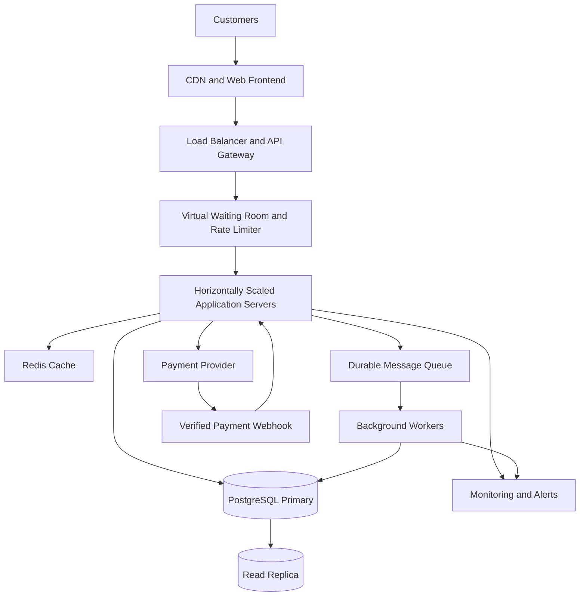

# TicketHub: Event Ticketing System Design

## 1. Requirements

### 1.1 Problem Statement

TicketHub is an online event ticketing platform that allows customers to browse concerts and other events, select seats, pay for tickets, and view their bookings.

The system must support normal daily traffic while handling sudden surges when popular concerts go on sale. Its most important correctness requirement is to prevent two customers from purchasing the same seat.

### 1.2 Functional Requirements

TicketHub must allow users to:

1. Register, log in, and manage their accounts.
2. Browse, search, and filter available events.
3. View event details, venue information, seat maps, and ticket prices.
4. Select one or more available seats and place a temporary hold.
5. Complete payment for held seats.
6. Receive booking confirmation and access their purchased tickets.
7. View their order history and cancel eligible bookings.
8. Receive notifications about successful bookings, payment failures, and cancellations.
9. Allow administrators to create events, configure seat inventories, set prices, and monitor sales.

### 1.3 Non-Functional Requirements

- **Performance:** Event pages should load within 300 milliseconds at the 95th percentile under normal conditions, excluding external payment processing.
- **Correctness:** The same seat for the same event must never be sold to two customers.
- **Scalability:** The system must support 2 million registered users and a large burst of traffic during popular sales.
- **Availability:** Event browsing and ticket viewing should remain available during heavy purchasing traffic.
- **Fairness:** A virtual waiting room should control admission during high-demand sales, with rate limiting and protection against automated purchasing.
- **Security:** The system must use HTTPS, authentication, authorization, secure password hashing, and a trusted payment provider.
- **Reliability:** Payment retries, network failures, and server restarts must not cause duplicate charges or inconsistent orders.
- **Consistency:** The primary database is the authoritative source for seat ownership. Cached seat availability must never be treated as proof that a seat can be purchased.
- **Maintainability:** The application should use documented APIs, automated tests, monitoring, logging, and clearly separated components.

## 2. Capacity Planning and Traffic Estimates

### 2.1 Normal-Day Traffic

The assignment provides these facts:

- Registered users: 2,000,000
- Daily visitors: 50,000
- Pages viewed per visitor: 10
- Tickets sold per day: 5,000

**Daily page views**

50,000 visitors × 10 pages = 500,000 page views per day.

**Average page views per second**

500,000 ÷ 86,400 seconds ≈ 5.8 page views per second.

**Average ticket sales rate**

5,000 ÷ 86,400 seconds ≈ 0.058 tickets per second.

This is approximately one ticket sold every 17 seconds.

For preliminary capacity planning, assume peak normal traffic reaches ten times the daily average:

5.8 × 10 ≈ 58 page views per second.

This is an assumption for planning, not a measured peak. Actual API request volume can be higher because one page may generate multiple requests.

### 2.2 Popular Concert Sale

The assignment provides these facts:

- Customers attempting to buy tickets: 200,000
- Available seats: 20,000
- Sale duration: 10 minutes, or 600 seconds

**Average customer arrival rate**

200,000 ÷ 600 ≈ 333 customer attempts per second.

**Seat supply rate**

20,000 ÷ 600 ≈ 33 seats per second if all seats sell evenly throughout the ten-minute window.

**Demand-to-supply ratio**

200,000 ÷ 20,000 = 10 customers per seat.

If every customer wants one seat and all seats are sold, only 10% of customers can obtain a ticket.

The arrival rate of approximately 333 attempts per second is an average. Actual traffic may be much higher during the first few seconds of the sale. Customers may also refresh seat maps, retry failed requests, and make multiple API calls during checkout.

### 2.3 Comparison

| Metric               | Normal traffic                 | Popular concert sale                                  |
| -------------------- | ------------------------------ | ----------------------------------------------------- |
| Visitors or attempts | 50,000 visitors per day        | 200,000 attempts in 10 minutes                        |
| Average traffic      | 5.8 page views/second          | 333 customer attempts/second                          |
| Ticket inventory     | 5,000 sales/day                | 20,000 seats                                          |
| Main challenge       | Efficient browsing             | Traffic bursts and seat contention                    |
| Main strategy        | Caching and horizontal scaling | Waiting room, rate limiting, transactions, and queues |

### 2.4 Capacity Strategy

TicketHub will use a CDN to serve static assets, Redis to cache frequently requested event details, and multiple application servers behind a load balancer.

During popular sales, a virtual waiting room will control the rate at which customers enter the purchasing workflow. Database transactions will protect seat ownership, while background workers will process notifications and other non-critical tasks.

Load testing is necessary to determine the safe admission rate, database capacity, and number of application instances. The system must prioritize correct bookings over accepting unlimited simultaneous purchase attempts.

## 3. REST API Design

The backend exposes a REST API using HTTPS and JSON. Authenticated endpoints require a valid access token.

### 3.1 API Endpoints

| Method and endpoint                | Purpose                                        | Expected response                         |
| ---------------------------------- | ---------------------------------------------- | ----------------------------------------- |
| `GET /events`                    | Browse, search, and filter events              | `200 OK`                                |
| `GET /events/{eventId}`          | View event details                             | `200 OK` or `404 Not Found`           |
| `GET /events/{eventId}/seats`    | View seats, prices, and displayed availability | `200 OK`                                |
| `POST /events/{eventId}/holds`   | Temporarily hold selected seats                | `201 Created` or `409 Conflict`       |
| `GET /holds/{holdId}`            | View the status and expiration of a hold       | `200 OK`                                |
| `DELETE /holds/{holdId}`         | Release an active hold                         | `204 No Content`                        |
| `POST /orders`                   | Create an order from a valid hold              | `201 Created` or `409 Conflict`       |
| `POST /orders/{orderId}/payment` | Initiate payment                               | `200 OK`, `202 Accepted`, or an error |
| `GET /me/orders`                 | View the authenticated user's orders           | `200 OK`                                |
| `GET /me/tickets`                | View purchased tickets                         | `200 OK`                                |

### 3.2 Example: Hold Seats

Request:

`POST /events/101/holds`

```json
{
  "seat_ids": [501, 502],
  "idempotency_key": "hold-request-123"
}
```

The server authenticates the user, verifies that the event is on sale, validates the requested seat IDs, and attempts to hold all requested seats in one database transaction.

Example successful response:

```json
{
  "hold_id": 789,
  "status": "ACTIVE",
  "seat_ids": [501, 502],
  "expires_at": "2026-10-14T12:00:00Z"
}
```

The expiration time is illustrative. The server generates the actual timestamp.

If either seat is unavailable, the server returns `409 Conflict` and rolls back the entire hold transaction. It must not hold one seat while silently failing to hold the other.

### 3.3 HTTP Error Handling

- `400 Bad Request`: Invalid input.
- `401 Unauthorized`: Missing or invalid authentication.
- `403 Forbidden`: The user is not permitted to perform the operation.
- `404 Not Found`: The requested event, hold, or order does not exist.
- `409 Conflict`: A seat is unavailable or its state conflicts with the requested operation.
- `429 Too Many Requests`: The request exceeds a rate limit.
- `503 Service Unavailable`: The service temporarily cannot accept the request.

The API should return a clear error message and a machine-readable error code. Retried hold and payment requests should use idempotency keys so the same logical request does not create duplicate effects.

## 4. Database Design and Table Schemas

### 4.1 Database Choice

TicketHub uses PostgreSQL as its primary relational database.

PostgreSQL is appropriate because it supports:

- ACID transactions.
- Row-level locking.
- Conditional updates.
- Foreign keys and unique constraints.
- Reliable concurrent access to shared inventory.

The database is the source of truth for seat ownership, holds, orders, and payment records.

### 4.2 Users Table

Stores registered customer accounts.

```sql
CREATE TABLE users (
    id BIGINT GENERATED ALWAYS AS IDENTITY PRIMARY KEY,
    email VARCHAR(255) NOT NULL UNIQUE,
    password_hash TEXT NOT NULL,
    created_at TIMESTAMPTZ NOT NULL DEFAULT CURRENT_TIMESTAMP
);
```

The email address must be unique. Passwords are stored as secure password hashes, never as plain text.

### 4.3 Events Table

Stores event information and sales status.

```sql
CREATE TABLE events (
    id BIGINT GENERATED ALWAYS AS IDENTITY PRIMARY KEY,
    name VARCHAR(255) NOT NULL,
    venue VARCHAR(255) NOT NULL,
    starts_at TIMESTAMPTZ NOT NULL,
    status VARCHAR(20) NOT NULL DEFAULT 'DRAFT'
        CHECK (
            status IN (
                'DRAFT',
                'ON_SALE',
                'SOLD_OUT',
                'CANCELLED'
            )
        )
);
```

Only events authorized for sale should accept new seat holds.

### 4.4 Seat Holds Table

Stores temporary reservations and their expiration times.

```sql
CREATE TABLE seat_holds (
    id BIGINT GENERATED ALWAYS AS IDENTITY PRIMARY KEY,
    user_id BIGINT NOT NULL REFERENCES users(id),
    event_id BIGINT NOT NULL REFERENCES events(id),
    status VARCHAR(20) NOT NULL DEFAULT 'ACTIVE'
        CHECK (
            status IN (
                'ACTIVE',
                'CONVERTED',
                'RELEASED',
                'EXPIRED'
            )
        ),
    expires_at TIMESTAMPTZ NOT NULL,
    created_at TIMESTAMPTZ NOT NULL DEFAULT CURRENT_TIMESTAMP
);
```

A hold belongs to one user and one event. It can contain several seats.

### 4.5 Seats Table

Each seat represents one seat in the inventory of a particular event.

```sql
CREATE TABLE seats (
    id BIGINT GENERATED ALWAYS AS IDENTITY PRIMARY KEY,
    event_id BIGINT NOT NULL REFERENCES events(id),
    seat_number VARCHAR(30) NOT NULL,
    price NUMERIC(12, 2) NOT NULL CHECK (price >= 0),
    status VARCHAR(20) NOT NULL DEFAULT 'AVAILABLE'
        CHECK (
            status IN ('AVAILABLE', 'HELD', 'SOLD')
        ),
    hold_id BIGINT REFERENCES seat_holds(id),
    hold_expires_at TIMESTAMPTZ,

    UNIQUE (event_id, seat_number),

    CHECK (
        (
            status = 'HELD'
            AND hold_id IS NOT NULL
            AND hold_expires_at IS NOT NULL
        )
        OR
        (
            status <> 'HELD'
            AND hold_id IS NULL
            AND hold_expires_at IS NULL
        )
    )
);
```

The `UNIQUE (event_id, seat_number)` constraint prevents duplicate seat definitions within an event.

The `hold_id` column identifies the current hold owner. The expiration timestamp determines when a temporary hold becomes eligible for reclamation.

### 4.6 Orders Table

Stores customer purchases and their overall status.

```sql
CREATE TABLE orders (
    id BIGINT GENERATED ALWAYS AS IDENTITY PRIMARY KEY,
    user_id BIGINT NOT NULL REFERENCES users(id),
    hold_id BIGINT NOT NULL UNIQUE REFERENCES seat_holds(id),
    status VARCHAR(20) NOT NULL DEFAULT 'PENDING'
        CHECK (
            status IN (
                'PENDING',
                'PAID',
                'FAILED',
                'CANCELLED',
                'REFUNDED'
            )
        ),
    total_amount NUMERIC(12, 2) NOT NULL
        CHECK (total_amount >= 0),
    idempotency_key VARCHAR(255) NOT NULL,
    created_at TIMESTAMPTZ NOT NULL DEFAULT CURRENT_TIMESTAMP,

    UNIQUE (user_id, idempotency_key)
);
```

The unique hold reference prevents multiple orders from being created for the same hold. The user-scoped idempotency key prevents duplicate order creation when a client retries the same request.

### 4.7 Order Items Table

Connects orders to the seats purchased in each order.

```sql
CREATE TABLE order_items (
    id BIGINT GENERATED ALWAYS AS IDENTITY PRIMARY KEY,
    order_id BIGINT NOT NULL REFERENCES orders(id),
    seat_id BIGINT NOT NULL REFERENCES seats(id),
    price_at_purchase NUMERIC(12, 2) NOT NULL
        CHECK (price_at_purchase >= 0),
    status VARCHAR(20) NOT NULL DEFAULT 'SOLD'
        CHECK (
            status IN ('SOLD', 'CANCELLED', 'REFUNDED')
        )
);

CREATE UNIQUE INDEX uq_order_items_active_seat
    ON order_items(seat_id)
    WHERE status = 'SOLD';
```

The partial unique index prevents the same seat from appearing in multiple active sold order items.

The seat status, order status, and order-item records must be changed together inside a transaction. A canceled or refunded seat may become available again only when the business policy allows resale and the relevant state changes are safely completed.

### 4.8 Payments Table

Stores payment attempts and provider references.

```sql
CREATE TABLE payments (
    id BIGINT GENERATED ALWAYS AS IDENTITY PRIMARY KEY,
    order_id BIGINT NOT NULL REFERENCES orders(id),
    provider_reference VARCHAR(255) UNIQUE,
    idempotency_key VARCHAR(255) NOT NULL UNIQUE,
    amount NUMERIC(12, 2) NOT NULL CHECK (amount >= 0),
    status VARCHAR(20) NOT NULL DEFAULT 'PENDING'
        CHECK (
            status IN (
                'PENDING',
                'SUCCEEDED',
                'FAILED',
                'REFUNDED'
            )
        ),
    created_at TIMESTAMPTZ NOT NULL DEFAULT CURRENT_TIMESTAMP
);
```

The unique payment reference and idempotency key help prevent duplicate recording of payment operations. The application must also verify payment-provider events and reconcile successful payments that have not yet been reflected in an order.

### 4.9 Database Relationships

- One user can create many seat holds.
- One user can place many orders.
- One event contains many seats.
- One event can have many seat holds.
- One hold belongs to one user and one event.
- One hold can reserve multiple seats.
- One order references one hold and contains one or more order items.
- Each order item references one seat.
- One order can have multiple payment attempts.

The main indexes support event searches, seat availability lookups, hold expiration processing, and customer order history.

The schema treats each seat as event-specific inventory. It is a simplified implementation suitable for demonstrating the system design.

## 5. Preventing Double-Booking

### 5.1 Core Principle

**An atomic conditional database update inside a transaction, backed by a uniqueness constraint, prevents two customers from successfully claiming the same seat.**

The CDN, Redis cache, and waiting room help with performance and traffic management, but they do not guarantee exclusive seat ownership.

### 5.2 Conditional SQL Update

For a single seat, the backend attempts to change its status only if it is currently available or its previous hold has expired.

```sql
BEGIN;

UPDATE seats
SET status = 'HELD',
    hold_id = :hold_id,
    hold_expires_at =
        CURRENT_TIMESTAMP + INTERVAL '10 minutes'
WHERE id = :seat_id
  AND event_id = :event_id
  AND (
      status = 'AVAILABLE'
      OR (
          status = 'HELD'
          AND hold_expires_at <= CURRENT_TIMESTAMP
      )
  )
RETURNING id;

-- Application checks the returned row count.
-- If exactly one row is returned, COMMIT.
-- If no row is returned, ROLLBACK and return HTTP 409.

COMMIT;
```

The final `COMMIT` is conditional in the application logic. The application must not commit after a failed update; it must roll back instead.

### 5.3 Why the Conditional Update Is Safe

Suppose Customer A and Customer B attempt to hold seat 501 simultaneously.

1. Both requests initially observe the seat as available.
2. Customer A's conditional update locks the seat row and changes its status to `HELD`.
3. Customer B's competing update must wait for the conflicting row update to finish.
4. After Customer A commits, PostgreSQL rechecks the update condition against the current row.
5. Because the seat is now held and the hold has not expired, Customer B's update affects zero rows.
6. Customer B receives `409 Conflict` instead of receiving the same seat.

This works because the database checks and changes the seat state as one atomic operation. The application does not rely on a separate read followed by an unconditional write.

### 5.4 Safely Holding Multiple Seats

A customer may request multiple seats. All requested seats must be held within one transaction.

The application should:

1. Validate the event, user, and seat IDs.
2. Reject duplicate seat IDs in the request.
3. Begin a transaction and create the hold record.
4. Update requested seats in a consistent order, using conditional updates.
5. Compare the complete set of returned seat IDs with the requested set.
6. Insert any required hold-item records.
7. Commit only if every requested seat is held successfully.
8. Roll back the entire transaction if even one seat is unavailable.

Illustrative transaction logic:

```sql
BEGIN;

-- Assume the hold record has been created in this transaction,
-- and its ID is available as :hold_id.

UPDATE seats
SET status = 'HELD',
    hold_id = :hold_id,
    hold_expires_at =
        CURRENT_TIMESTAMP + INTERVAL '10 minutes'
WHERE event_id = :event_id
  AND id = ANY(:seat_ids)
  AND (
      status = 'AVAILABLE'
      OR (
          status = 'HELD'
          AND hold_expires_at <= CURRENT_TIMESTAMP
      )
  )
RETURNING id;

-- Application verifies that every requested seat was updated.
-- If the returned IDs do not match the requested IDs:
-- ROLLBACK.
-- Otherwise, insert hold-item records if used and COMMIT.

COMMIT;
```

As with the single-seat example, the application must choose one outcome: `COMMIT` if all seats were claimed, or `ROLLBACK` if any seat failed. In production, sort seat IDs before acquiring locks and keep the transaction short to reduce deadlocks.

### 5.5 Database Constraint as a Second Defense

The partial unique index:

```sql
CREATE UNIQUE INDEX uq_order_items_active_seat
    ON order_items(seat_id)
    WHERE status = 'SOLD';
```

prevents two active sold order-item records from referencing the same seat.

During purchase confirmation, the backend must transactionally:

1. Lock and validate the order and hold.
2. Verify the payment result using a trusted payment-provider event.
3. Confirm that the hold is eligible for conversion.
4. Change the seat status to `SOLD` and clear the hold fields.
5. Insert the sold order-item records.
6. Change the order to `PAID` and the hold to `CONVERTED`.
7. Commit all database changes together.

If a constraint or validation fails, the database transaction rolls back. The backend must reconcile the payment state if the external payment already succeeded.

### 5.6 Hold Expiration and Recovery

Expired holds are released through a background worker or safely reclaimed by a subsequent conditional update. The worker must lock and recheck the hold and seat state before releasing inventory.

An expired timestamp alone must not release a seat already sold or one undergoing valid payment confirmation. Hold conversion, expiration, and release must be coordinated through transactions.

The seat map may display slightly stale information from Redis, but every purchase attempt must be validated against the authoritative database.

## 6. System Architecture

### 6.1 Architecture Diagram



### 6.2 Architecture Components

**CDN and Web Frontend**

The CDN serves static JavaScript, CSS, images, and other public assets close to users. This reduces latency and prevents static requests from unnecessarily consuming application-server capacity.

**Load Balancer and API Gateway**

The load balancer distributes requests across multiple application servers. The API gateway handles routing, request validation, authentication integration, and rate limiting.

**Virtual Waiting Room**

The waiting room controls admission during popular sales. It prevents 200,000 customers from simultaneously overwhelming the seat-hold and checkout services.

Queue positions and admission tokens must be managed server-side. The system should provide clear queue status and apply rate limits and abuse detection.

**Application Servers**

Application servers implement authentication, event browsing, seat holds, orders, payments, and ticket retrieval. Because the instances are stateless, more servers can be added when demand increases.

**Redis Cache**

Redis stores frequently requested event information and other cacheable data. This reduces database reads and improves response time. Cached seat availability is for display only; the primary database validates every hold.

**PostgreSQL Primary**

The primary database stores users, events, seats, holds, orders, and payments. Conditional updates, row-level locks, transactions, and constraints enforce correct inventory ownership.

**Read Replica**

A read replica supports suitable read-heavy queries, such as event browsing and reporting. Critical seat-allocation decisions must be validated against the primary database.

**Durable Message Queue and Background Workers**

The queue and workers process email notifications, ticket generation, hold cleanup, and payment reconciliation. Tasks should be retryable and idempotent so retries do not create duplicate side effects.

**Payment Provider**

The external provider processes payment securely. Verified callbacks communicate payment outcomes to TicketHub. The backend stores payment references and necessary transaction metadata rather than raw card details.

**Monitoring and Alerts**

Monitoring tracks response latency, request volume, database contention, queue length, failed payments, active holds, and successful sales. Alerts help operators identify bottlenecks before they cause widespread failures.

### 6.3 How the System Handles a Popular Sale

1. The CDN serves static assets without sending every request to the backend.
2. The waiting room limits the rate of customers entering the purchase flow.
3. Multiple application servers process admitted requests.
4. Redis reduces repeated reads for event details and public metadata.
5. PostgreSQL serializes conflicting seat updates and enforces uniqueness.
6. Background workers handle notifications and other non-critical tasks.
7. Monitoring detects increasing queue length, database latency, and payment failures.
8. If the system reaches its safe capacity, it queues or temporarily rejects new purchase attempts rather than compromising booking correctness.

Before a major sale, the team should load-test burst traffic, concurrent seat requests, database lock contention, payment timeouts, and application-server failures.

## 7. Trade-Offs

### 7.1 Strong Consistency vs. Read Performance

Using database transactions for seat holds and purchases protects correctness but can increase latency when many customers request the same seats.

**Decision:** Prioritize correctness for inventory ownership. Use Redis and read replicas for suitable read operations, while validating every hold against the primary database.

### 7.2 Fairness vs. Immediate Access

A waiting room introduces extra waiting time, but admitting every customer directly can overload the purchase system.

**Decision:** Use controlled admission for high-demand events, provide clear queue information, and apply rate limits and automated-abuse protection. Normal event browsing remains available.

### 7.3 Hold Duration vs. Inventory Utilization

Long holds give customers more time to complete checkout but keep seats unavailable when customers abandon the process. Short holds release seats faster but can inconvenience customers.

**Decision:** Use a limited hold duration with a visible countdown, a clear expiration policy, and safe handling of payment operations already in progress.

### 7.4 Synchronous vs. Asynchronous Processing

Processing every task synchronously makes the application simpler but can increase latency when external services are slow.

**Decision:** Keep seat allocation and order-state transitions transactional. Use durable background processing for email notifications, analytics, and payment reconciliation.

## 8. Conclusion

TicketHub combines a CDN, load balancer, virtual waiting room, horizontally scaled application servers, Redis, PostgreSQL, and background workers to handle both everyday browsing and sudden ticket-sale surges.

The system's most important correctness guarantee comes from atomic conditional database updates inside transactions, supported by row-level locking and a unique constraint on active sold seats. These mechanisms prevent double-booking while caching, horizontal scaling, and controlled admission help the system remain responsive during popular sales.

The design balances performance, fairness, reliability, and correctness while providing a foundation for future growth.
