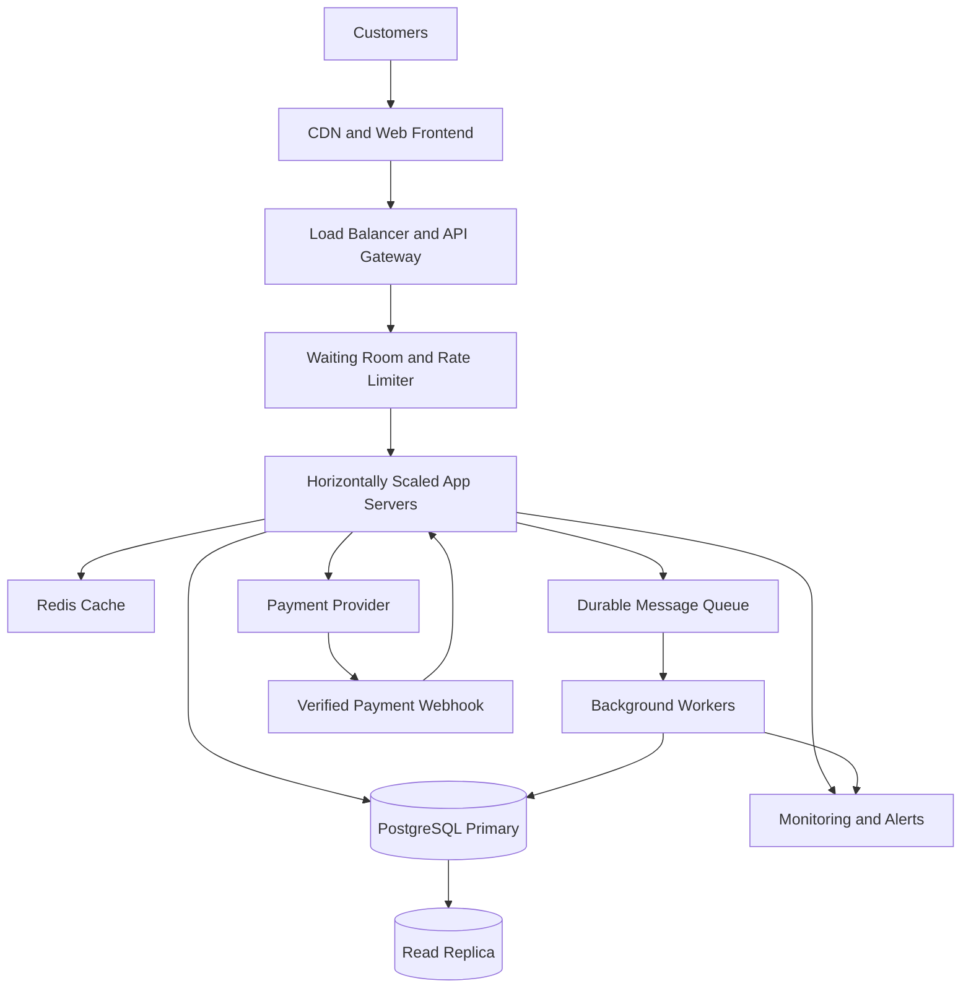

# TicketHub: Event Ticketing System Design

## 1. Requirements

### 1.1 Functional Requirements

TicketHub is a web application that allows customers to discover events, select seats, purchase tickets, and manage their bookings.

The system must allow users to:

1. Register, log in, and manage their accounts.
2. Browse, search, and filter events.
3. View event details, seat availability, and ticket prices.
4. Temporarily hold one or more available seats.
5. Pay for held seats and receive booking confirmation.
6. View purchased tickets and order history.
7. Cancel eligible bookings according to the event's cancellation policy.
8. Allow administrators to create events, configure seats, set prices, and monitor sales.

### 1.2 Non-Functional Requirements

- **Performance:** Event pages should load within 300 ms at the 95th percentile under normal conditions, excluding external payment processing.
- **Correctness:** The same seat for the same event must never be sold to two customers.
- **Fairness:** A waiting room should control admission during high-demand sales, with rate limiting and protection against automated purchasing.
- **Scalability:** The system must support 2 million registered users and sudden traffic spikes.
- **Availability:** Browsing and ticket viewing should remain available when purchasing traffic increases.
- **Security:** Use authentication, authorization, HTTPS, secure payment integration, and protection against abuse.
- **Reliability:** Payment retries and service failures must not create duplicate charges or inconsistent orders.
- **Consistency:** The database, not a cache, must be the authoritative source for seat availability and ownership.
- **Maintainability:** Use documented APIs, automated tests, logging, monitoring, and clearly separated components.

## 2. Capacity Planning and Estimates

### 2.1 Normal Traffic

Given:

- Registered users: 2,000,000
- Daily visitors: 50,000
- Pages viewed per visitor: 10
- Tickets sold per day: 5,000

Daily page views:

50,000 × 10 = **500,000 page views/day**

Average page views per second:

500,000 ÷ 86,400 ≈ **5.8 page views/second**

Average ticket sales rate:

5,000 ÷ 86,400 ≈ **0.058 tickets/second**, or about one ticket every 17 seconds.

Assuming peak traffic is 10 times the daily average, the normal peak would be approximately **58 page views/second**. This is a planning assumption, not a measured traffic figure.

### 2.2 Popular Concert Sale

Given:

- Customers attempting to buy tickets: 200,000
- Available seats: 20,000
- Sale window: 10 minutes = 600 seconds

Average customer arrival rate:

200,000 ÷ 600 ≈ **333 customer attempts/second**

Seat supply rate if all seats sell evenly:

20,000 ÷ 600 ≈ **33 seats/second**

Demand-to-supply ratio:

200,000 ÷ 20,000 = **10 customers per seat**

If every customer wants one seat, only 10% of customers can obtain a ticket. Actual traffic may be much more concentrated in the first few seconds, and each customer may generate multiple API requests.

### 2.3 Comparison and Scaling Strategy

| Metric                          | Normal traffic                 | Popular sale                                            |
| ------------------------------- | ------------------------------ | ------------------------------------------------------- |
| Visitors or attempts            | 50,000 visitors/day            | 200,000 attempts/10 minutes                             |
| Average request or arrival rate | 5.8 page views/second          | 333 customer attempts/second                            |
| Ticket inventory                | 5,000 sales/day                | 20,000 seats                                            |
| Main challenge                  | Efficient browsing             | Traffic bursts and seat contention                      |
| Main solution                   | Caching and horizontal scaling | Waiting room, rate limiting, transactions, and queueing |

The popular sale requires more than additional application servers. A waiting room controls admission, caching reduces unnecessary reads, and database transactions protect seat ownership. Load testing is necessary to determine the actual capacity limits.

## 3. REST API Design

The API uses JSON over HTTPS. Authenticated endpoints require a valid access token.

| Method and endpoint                | Purpose                               |
| ---------------------------------- | ------------------------------------- |
| `GET /events`                    | Browse and search events              |
| `GET /events/{eventId}`          | View event details                    |
| `GET /events/{eventId}/seats`    | View seat availability and prices     |
| `POST /events/{eventId}/holds`   | Temporarily hold selected seats       |
| `DELETE /holds/{holdId}`         | Release an active hold                |
| `POST /orders`                   | Create an order from a valid hold     |
| `POST /orders/{orderId}/payment` | Initiate payment                      |
| `GET /me/tickets`                | View the authenticated user's tickets |

### Example: Hold Seats

Request:

`POST /events/101/holds`

```json
{
  "seat_ids": [501, 502],
  "idempotency_key": "hold-request-123"
}
```

If both seats are available, the server creates a hold and returns:

```json
{
  "hold_id": "hold-789",
  "status": "HELD",
  "seat_ids": [501, 502],
  "expires_at": "2026-10-14T11:35:00Z"
}
```

The expiration time is illustrative; the server must generate the actual timestamp.

If any requested seat is unavailable, the server returns `409 Conflict` and does not hold any of the requested seats.

### Important HTTP Status Codes

- `200 OK`: Request succeeded.
- `201 Created`: A hold or order was created.
- `204 No Content`: A hold was released successfully.
- `400 Bad Request`: Invalid request.
- `401 Unauthorized`: Missing or invalid authentication.
- `404 Not Found`: Event, hold, or order does not exist.
- `409 Conflict`: Seat is unavailable or a state conflict occurred.
- `429 Too Many Requests`: Rate limit exceeded.
- `503 Service Unavailable`: Service temporarily cannot accept the request.

Payment requests must use an idempotency key. A verified payment-provider callback, not merely a browser redirect, confirms whether payment succeeded.

## 4. Database Design and Table Schemas

TicketHub uses PostgreSQL because it supports relational constraints, transactions, row-level locks, and reliable concurrent updates.

The following schema is a simplified implementation suitable for the assignment.

### 4.1 SQL Table Definitions

```sql
CREATE TABLE users (
    id BIGINT GENERATED ALWAYS AS IDENTITY PRIMARY KEY,
    email VARCHAR(255) NOT NULL UNIQUE,
    password_hash TEXT NOT NULL,
    created_at TIMESTAMPTZ NOT NULL DEFAULT CURRENT_TIMESTAMP
);

CREATE TABLE events (
    id BIGINT GENERATED ALWAYS AS IDENTITY PRIMARY KEY,
    name VARCHAR(255) NOT NULL,
    venue VARCHAR(255) NOT NULL,
    starts_at TIMESTAMPTZ NOT NULL,
    status VARCHAR(20) NOT NULL DEFAULT 'DRAFT'
        CHECK (status IN ('DRAFT', 'ON_SALE', 'SOLD_OUT', 'CANCELLED'))
);

CREATE TABLE seats (
    id BIGINT GENERATED ALWAYS AS IDENTITY PRIMARY KEY,
    event_id BIGINT NOT NULL REFERENCES events(id),
    seat_number VARCHAR(30) NOT NULL,
    price NUMERIC(12, 2) NOT NULL CHECK (price >= 0),
    status VARCHAR(20) NOT NULL DEFAULT 'AVAILABLE'
        CHECK (status IN ('AVAILABLE', 'HELD', 'SOLD')),
    hold_id BIGINT,
    hold_expires_at TIMESTAMPTZ,
    UNIQUE (event_id, seat_number),
    CHECK (
        (status = 'HELD' AND hold_id IS NOT NULL
            AND hold_expires_at IS NOT NULL)
        OR
        (status <> 'HELD' AND hold_id IS NULL
            AND hold_expires_at IS NULL)
    )
);

CREATE TABLE seat_holds (
    id BIGINT GENERATED ALWAYS AS IDENTITY PRIMARY KEY,
    user_id BIGINT NOT NULL REFERENCES users(id),
    event_id BIGINT NOT NULL REFERENCES events(id),
    status VARCHAR(20) NOT NULL DEFAULT 'ACTIVE'
        CHECK (status IN ('ACTIVE', 'CONVERTED', 'RELEASED', 'EXPIRED')),
    expires_at TIMESTAMPTZ NOT NULL,
    created_at TIMESTAMPTZ NOT NULL DEFAULT CURRENT_TIMESTAMP
);

ALTER TABLE seats
    ADD CONSTRAINT fk_seats_hold
    FOREIGN KEY (hold_id) REFERENCES seat_holds(id);

CREATE TABLE orders (
    id BIGINT GENERATED ALWAYS AS IDENTITY PRIMARY KEY,
    user_id BIGINT NOT NULL REFERENCES users(id),
    hold_id BIGINT NOT NULL UNIQUE REFERENCES seat_holds(id),
    status VARCHAR(20) NOT NULL DEFAULT 'PENDING'
        CHECK (status IN ('PENDING', 'PAID', 'FAILED', 'CANCELLED', 'REFUNDED')),
    total_amount NUMERIC(12, 2) NOT NULL CHECK (total_amount >= 0),
    idempotency_key VARCHAR(255) NOT NULL,
    created_at TIMESTAMPTZ NOT NULL DEFAULT CURRENT_TIMESTAMP,
    UNIQUE (user_id, idempotency_key)
);

CREATE TABLE order_items (
    id BIGINT GENERATED ALWAYS AS IDENTITY PRIMARY KEY,
    order_id BIGINT NOT NULL REFERENCES orders(id),
    seat_id BIGINT NOT NULL REFERENCES seats(id),
    price_at_purchase NUMERIC(12, 2) NOT NULL
        CHECK (price_at_purchase >= 0),
    status VARCHAR(20) NOT NULL DEFAULT 'SOLD'
        CHECK (status IN ('SOLD', 'CANCELLED', 'REFUNDED'))
);

-- A seat cannot appear in two active sold order items.
CREATE UNIQUE INDEX uq_order_items_active_seat
    ON order_items(seat_id)
    WHERE status = 'SOLD';

CREATE TABLE payments (
    id BIGINT GENERATED ALWAYS AS IDENTITY PRIMARY KEY,
    order_id BIGINT NOT NULL REFERENCES orders(id),
    provider_reference VARCHAR(255) UNIQUE,
    idempotency_key VARCHAR(255) NOT NULL UNIQUE,
    amount NUMERIC(12, 2) NOT NULL CHECK (amount >= 0),
    status VARCHAR(20) NOT NULL DEFAULT 'PENDING'
        CHECK (status IN ('PENDING', 'SUCCEEDED', 'FAILED', 'REFUNDED')),
    created_at TIMESTAMPTZ NOT NULL DEFAULT CURRENT_TIMESTAMP
);

CREATE INDEX idx_events_status_start
    ON events(status, starts_at);

CREATE INDEX idx_seats_event_status
    ON seats(event_id, status);

CREATE INDEX idx_holds_expiration
    ON seat_holds(status, expires_at);

CREATE INDEX idx_orders_user_created
    ON orders(user_id, created_at);
```

**Schema note:** In this simplified design, `seats` represents seats assigned to a specific event, not reusable physical venue seats. Each event has its own seat inventory.

### 4.2 Relationships

- One user can create many seat holds and orders.
- One event has many seats and seat holds.
- Each seat hold belongs to one user and one event.
- A hold can reserve multiple seats.
- An order references one hold and contains one or more order items.
- Each order item references one seat and records the purchase price.
- An order can have multiple payment attempts.
- A unique index on active sold order items provides an additional safeguard against selling the same seat twice.

The seat status and the sold-order constraint must be updated in the same transaction. Canceled or refunded seats should only become available for resale when the business policy permits it and the corresponding state changes have been completed safely.

## 5. Preventing Double-Booking With Transactions and SQL

**The primary guarantee is an atomic conditional database update inside a transaction, backed by uniqueness constraints.** Redis, the CDN, and the waiting room improve performance or manage traffic, but none of them guarantees exclusive ownership of a seat.

### 5.1 Safe Seat-Hold Transaction

The application generates a unique hold ID, begins a transaction, inserts the hold record, and then conditionally updates the requested seats.

The following is PostgreSQL-style application transaction logic. The application must execute all statements on the same database connection and transaction.

```sql
BEGIN;

-- 1. Create the hold.
INSERT INTO seat_holds (user_id, event_id, expires_at)
VALUES (:user_id, :event_id, :expires_at)
RETURNING id;

-- Save the returned ID as :hold_id.

-- 2. Atomically claim only available or expired-held seats.
UPDATE seats
SET status = 'HELD',
    hold_id = :hold_id,
    hold_expires_at = :expires_at
WHERE event_id = :event_id
  AND id = ANY(:seat_ids)
  AND (
      status = 'AVAILABLE'
      OR (
          status = 'HELD'
          AND hold_expires_at <= CURRENT_TIMESTAMP
      )
  )
RETURNING id;
```

**Application-side transaction rule:**

1. Compare the returned seat IDs with the complete requested seat ID list.
2. If every requested seat was updated, insert any required hold-item records and commit.
3. If even one requested seat was not updated, roll back the entire transaction and return `409 Conflict`.

```sql
-- Execute only when every requested seat was successfully held.
COMMIT;

-- Otherwise, execute instead:
ROLLBACK;
```

The `COMMIT` and `ROLLBACK` are mutually exclusive outcomes, not statements to run one after the other.

**Why this works:** PostgreSQL locks rows during updates. If two customers request the same available seat, one transaction can claim it first. The competing update cannot also change that seat from available to held. The second request will fail to update that seat and must roll back its entire multi-seat hold.

The server must also validate that the event is on sale, the user is authorized, and the requested seats belong to the specified event. Duplicate or malformed seat IDs must be rejected before processing.

### 5.2 Expired Holds

An expired hold may be reclaimed through the conditional update, but the previous hold record must also be marked expired consistently.

A background worker can process expired holds in batches. It should lock and recheck the hold and seat records inside a transaction before releasing inventory. It must never release seats that have already been sold or that are involved in a valid payment confirmation.

### 5.3 Payment and Final Confirmation

1. The customer initiates payment for a valid hold.
2. The backend creates an order and records a pending payment attempt.
3. The payment provider processes the payment using an idempotency key.
4. A verified provider callback reports the payment result.
5. The backend locks and validates the relevant order, hold, and seats.
6. Within a database transaction, it confirms that the hold remains eligible for conversion, marks the seats sold, inserts order items, changes the order to `PAID`, and marks the hold `CONVERTED`.
7. It commits the changes together.

If any database step fails, the transaction rolls back. Because an external payment cannot participate in the PostgreSQL transaction, the backend must record and reconcile payment results safely. If payment succeeds but confirmation cannot complete, a retryable reconciliation process must resolve the state without charging the customer again.

The partial unique index on sold order items provides a final database-level defense against duplicate sales. The application must also ensure that order items, seat states, and payment records remain consistent within each transaction.

## 6. System Architecture

### 6.1 Architecture Diagram



### 6.2 Component Responsibilities

**CDN and Web Frontend:** Serves static files such as JavaScript, CSS, images, and public event assets close to users.

**Load Balancer and API Gateway:** Distributes traffic across application instances and provides request routing, TLS termination, and rate-limit enforcement.

**Waiting Room and Rate Limiter:** Controls entry into the purchase flow during popular sales. Queue positions and admission tokens must be managed server-side, not trusted from the client.

**Application Servers:** Handle authentication, event browsing, seat holds, order creation, and ticket retrieval. Stateless instances can be added horizontally.

**Redis Cache:** Stores frequently requested event details and other cacheable data. Seat-map availability may be cached for display, but every hold request must validate the authoritative database.

**PostgreSQL Primary:** Stores users, events, seats, holds, orders, and payments. Transactions, row locks, conditional updates, and constraints preserve inventory correctness.

**Read Replica:** Supports suitable read-heavy queries such as event browsing and reporting. Seat-allocation decisions must use the authoritative primary database.

**Durable Message Queue and Background Workers:** Handle email notifications, ticket generation, expired-hold cleanup, and payment reconciliation. Tasks must be retryable and idempotent.

**Payment Provider:** Processes payments securely and reports verified outcomes to the backend. TicketHub stores payment references and transaction metadata rather than raw card details.

**Monitoring and Alerts:** Tracks latency, error rates, queue length, database contention, payment failures, active holds, and successful sales.

### 6.3 Handling the Popular Sale

1. The CDN serves static assets without routing every request to the application.
2. The waiting room controls how many customers enter the purchase flow per second.
3. Multiple application servers handle admitted requests.
4. Redis reduces repeated reads for event details and public metadata.
5. PostgreSQL transactions serialize conflicting seat updates and enforce uniqueness.
6. Background workers process notifications and reconciliation without delaying the main request unnecessarily.
7. Monitoring alerts operators when database latency, queue length, or payment failures increase.
8. If capacity is exceeded, the system queues or rejects new purchase attempts temporarily rather than compromising seat correctness.

The team must conduct load tests to establish safe admission rates and test concurrent seat requests, payment timeouts, application failures, and database contention.

## 7. Trade-Offs

### 7.1 Strong Consistency vs. Read Performance

Database transactions protect seat ownership but may increase latency and contention during a popular sale.

**Decision:** Prioritize correctness for seat allocation. Use caching and read replicas for suitable read operations, while validating every hold against the primary database.

### 7.2 Fairness vs. Immediate Access

A waiting room adds waiting time but prevents the purchase system from being overwhelmed.

**Decision:** Enable controlled admission for high-demand sales while keeping ordinary event browsing available. Provide clear queue information and protect against automated abuse.

### 7.3 Hold Duration vs. Inventory Utilization

Long holds improve convenience but keep inventory unavailable when customers abandon checkout. Short holds release seats faster but can inconvenience customers during payment.

**Decision:** Use a limited hold duration, display a countdown, and define a safe policy for payment operations already in progress.

### 7.4 Synchronous vs. Asynchronous Processing

Processing every task synchronously simplifies the initial design but makes customer requests slower when external services are delayed.

**Decision:** Keep inventory and order-state changes transactional. Use durable background processing for notifications, analytics, and payment reconciliation.

## 8. Conclusion

TicketHub combines a CDN, load balancer, waiting room, horizontally scaled application servers, Redis, PostgreSQL, and background workers to handle both everyday browsing and sudden ticket-sale surges.

The critical correctness mechanism is an atomic conditional seat update within a database transaction, backed by database constraints that prevent duplicate sales. This design balances performance, fairness, reliability, and correctness while supporting future growth.
