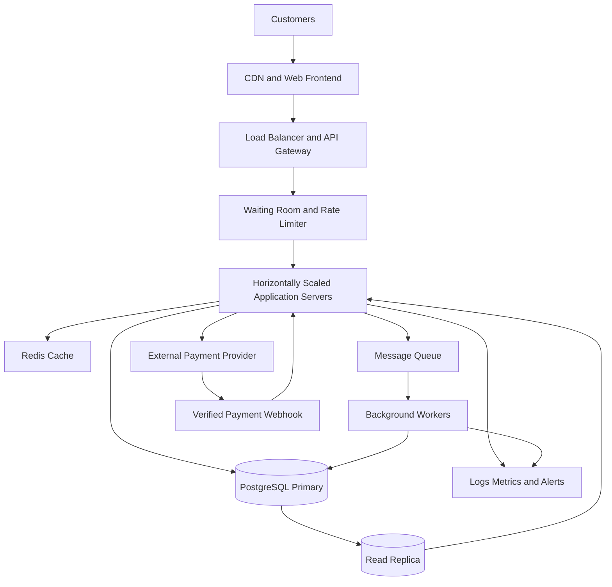

# TicketHub: Event Ticketing System Design

## 1. Requirements

### 1.1 Functional Requirements

TicketHub is a website where users can discover events, select seats, purchase tickets, and view their bookings.

The system must allow users to:

1. Register, log in, and manage their accounts.
2. Browse, search, and filter concerts and other events.
3. View event details, ticket prices, and seat availability.
4. Select and temporarily hold available seats.
5. Complete payment for held seats.
6. Receive booking confirmation and view purchased tickets.
7. Cancel eligible bookings and receive refunds according to the event's policy.
8. Allow administrators to create events, configure seats and prices, and monitor sales.

### 1.2 Non-Functional Requirements

- **Performance:** Event pages should load within 300 ms at the 95th percentile under normal conditions, excluding external payment processing. Seat availability requests should be fast enough to provide a responsive booking experience.
- **Correctness:** A seat must never be sold to two customers for the same event.
- **Availability:** Browsing and ticket viewing should remain available during increased traffic, even if purchasing is temporarily queued or rate-limited.
- **Scalability:** The application must support 2 million registered users and handle a large concert-sale burst.
- **Fairness:** During a popular sale, customers should enter a waiting room and receive controlled access to seat selection and checkout. The system should enforce hold expiration and rate limits.
- **Security:** Authentication, authorization, encrypted connections, secure payment processing, and protection against automated purchasing must be implemented.
- **Reliability:** Orders and payment results must be recoverable after a timeout or service failure. Payment requests must support idempotency to prevent duplicate charges.
- **Consistency:** Seat availability, seat holds, and confirmed orders must be managed using authoritative database transactions rather than trusting cached data.
- **Maintainability:** The system should use documented APIs, automated tests, monitoring, and clearly separated components.

## 2. Traffic and Capacity Estimates

### 2.1 Normal-Day Traffic

Given:

- Registered users: 2,000,000
- Daily visitors: 50,000
- Pages viewed per visitor: 10
- Tickets sold per day: 5,000

**Daily page views**

50,000 visitors × 10 pages = **500,000 page views/day**

**Average page requests per second**

500,000 ÷ 86,400 seconds ≈ **5.8 requests/second**

**Average ticket sales rate**

5,000 ÷ 86,400 ≈ **0.058 tickets/second**, or approximately one ticket every 17 seconds.

These are averages. Actual traffic will vary by time of day, and one page view may generate multiple API requests.

For preliminary capacity planning, assume normal peak traffic can reach 10 times the daily average:

5.8 × 10 ≈ **58 page requests/second**.

### 2.2 Popular Concert Sale

Given:

- Customers attempting to buy tickets: 200,000
- Seats available: 20,000
- Sale window: 10 minutes (600 seconds)

**Average arrival rate during the sale**

200,000 ÷ 600 ≈ **333 customer attempts/second**.

**Seat supply**

20,000 ÷ 600 ≈ **33 seats sold/second** if every seat is sold evenly across the 10-minute window.

**Demand compared with supply**

200,000 ÷ 20,000 = **10 customers per available seat**.

Only 10% of the customers can obtain a seat if each customer buys one seat and all seats are sold.

The 333 attempts/second figure is an average across the sale window. Real traffic may arrive in a much larger burst during the first few seconds. Seat-map refreshes, retries, and checkout calls can also create additional API traffic.

### 2.3 Comparison

| Metric                    |                     Normal day |                                                 Popular sale |
| ------------------------- | -----------------------------: | -----------------------------------------------------------: |
| Visitors or sale attempts |                     50,000/day |                                           200,000/10 minutes |
| Page views or attempts    |         500,000 page views/day |                      333 customer attempts/second on average |
| Ticket supply or sales    |              5,000 tickets/day |                                                 20,000 seats |
| Main challenge            |    Efficient everyday browsing |                            Sudden demand and seat contention |
| Main strategy             | Caching and horizontal scaling | Waiting room, rate limits, queues, and database transactions |

The popular sale creates a concentrated workload that cannot be handled safely by simply increasing the number of application servers. TicketHub must also protect the database from excessive concurrent seat reservations.

## 3. API Design

The API uses REST principles and JSON request and response bodies. Authenticated endpoints require a valid access token.

| Method and endpoint                | Purpose                                                     | Typical response                                      |
| ---------------------------------- | ----------------------------------------------------------- | ----------------------------------------------------- |
| `GET /events`                    | Browse and search events                                    | `200 OK`                                            |
| `GET /events/{eventId}`          | View event details                                          | `200 OK` or `404 Not Found`                       |
| `GET /events/{eventId}/seats`    | View seat availability and prices                           | `200 OK`                                            |
| `POST /events/{eventId}/holds`   | Temporarily hold selected seats                             | `201 Created` or `409 Conflict`                   |
| `DELETE /holds/{holdId}`         | Release a seat hold                                         | `204 No Content`                                    |
| `POST /orders`                   | Create an order from a valid hold                           | `201 Created` or `409 Conflict`                   |
| `POST /orders/{orderId}/payment` | Initiate or confirm payment through the payment integration | `200 OK`, `202 Accepted`, or an appropriate error |
| `GET /me/tickets`                | List the authenticated user's purchased tickets             | `200 OK`                                            |

### Example: Hold Seats

Request:

`POST /events/101/holds`

```json
{
  "seat_ids": [501, 502],
  "idempotency_key": "hold-unique-123"
}
```

The server checks availability and attempts to reserve both seats in one database transaction. If either seat is unavailable, the transaction fails and no partial hold is created.

Example response:

```json
{
  "hold_id": "hold-789",
  "status": "HELD",
  "seat_ids": [501, 502],
  "expires_at": "2026-10-14T11:35:00Z"
}
```

The expiration timestamp is illustrative. In production, it must be generated by the server.

### Example: Error Responses

- `400 Bad Request`: Invalid input.
- `401 Unauthorized`: Authentication is missing or invalid.
- `403 Forbidden`: The user lacks permission.
- `404 Not Found`: The event, hold, or order does not exist.
- `409 Conflict`: A requested seat is already held or sold.
- `429 Too Many Requests`: The user has exceeded a rate limit.
- `503 Service Unavailable`: Purchasing is temporarily unavailable.

The payment endpoint must use an idempotency key and a payment-provider webhook or equivalent verified callback. A browser redirect alone must not be treated as proof of successful payment.

## 4. Data Model

TicketHub uses a relational database such as PostgreSQL because seat ownership and order correctness require transactions, foreign keys, and uniqueness constraints.

### 4.1 Tables

**Users**

| Column            | Purpose                                               |
| ----------------- | ----------------------------------------------------- |
| `id` (PK)       | Unique user identifier                                |
| `email`         | User email; unique                                    |
| `password_hash` | Secure password hash, if local authentication is used |
| `created_at`    | Account creation timestamp                            |

**Events**

| Column        | Purpose                               |
| ------------- | ------------------------------------- |
| `id` (PK)   | Unique event identifier               |
| `name`      | Event name                            |
| `venue`     | Event venue                           |
| `starts_at` | Event start time                      |
| `status`    | Draft, on sale, sold out, or canceled |

**Seats**

| Column                         | Purpose                              |
| ------------------------------ | ------------------------------------ |
| `id` (PK)                    | Unique seat identifier               |
| `event_id` (FK)              | References`Events.id`              |
| `seat_number`                | Seat label within the event          |
| `price`                      | Ticket price                         |
| `status`                     | Available, held, or sold             |
| `hold_id` (nullable)         | Active hold identifier               |
| `hold_expires_at` (nullable) | Expiration time for a temporary hold |

Constraint: `UNIQUE(event_id, seat_number)` prevents duplicate seat definitions for the same event.

**Orders**

| Column           | Purpose                                      |
| ---------------- | -------------------------------------------- |
| `id` (PK)      | Unique order identifier                      |
| `user_id` (FK) | References`Users.id`                       |
| `status`       | Pending, paid, failed, canceled, or refunded |
| `total_amount` | Total order amount                           |
| `created_at`   | Order creation timestamp                     |

**SeatHolds**

| Column           | Purpose                        |
| ---------------- | ------------------------------ |
| `id` (PK)      | Unique hold identifier         |
| `user_id` (FK) | References`Users.id`         |
| `expires_at`   | Hold expiration timestamp      |
| `status`       | Active, converted, or released |

A join table named `SeatHoldItems` links each hold to its selected seats. Its columns are `hold_id` (FK) and `seat_id` (FK), with a composite primary key on both columns.

**OrderItems**

| Column                | Purpose                       |
| --------------------- | ----------------------------- |
| `id` (PK)           | Unique order-item identifier  |
| `order_id` (FK)     | References`Orders.id`       |
| `seat_id` (FK)      | References`Seats.id`        |
| `price_at_purchase` | Price recorded when purchased |
| `status`            | Sold, canceled, or refunded   |

The database must enforce that a seat cannot have more than one active sale. In PostgreSQL, this can be implemented with a partial unique index on `OrderItems(seat_id)` for rows whose status is `SOLD`. The application must change the status transactionally when a cancellation or refund makes a seat eligible for resale.

**Payments**

| Column                 | Purpose                                 |
| ---------------------- | --------------------------------------- |
| `id` (PK)            | Unique payment identifier               |
| `order_id` (FK)      | References`Orders.id`                 |
| `provider_reference` | Payment provider transaction reference  |
| `amount`             | Payment amount                          |
| `status`             | Pending, succeeded, failed, or refunded |

A unique constraint on the provider reference prevents duplicate recording of the same provider transaction. Payment retries must also be idempotent.

### 4.2 Relationships

- One user can create many orders.
- One event has many seats.
- One user can create many seat holds.
- One hold can contain multiple seats, and each seat can appear in different historical holds over time.
- One order contains one or more order items.
- Each order item references one seat.
- An order can have multiple payment attempts, depending on the payment policy.

Foreign keys protect referential integrity. Appropriate indexes should be added for event searches, seat lookups, user orders, active holds, and payment references.

## 5. Preventing Double-Booking

**The authoritative protection is an atomic database transaction, a conditional seat update, and a uniqueness constraint.** A cache, CDN, or waiting room alone cannot guarantee that a seat is sold only once.

### 5.1 Seat-Hold Process

1. The customer selects seats and requests a hold.
2. The server begins a database transaction.
3. It atomically changes each requested seat from `AVAILABLE` to `HELD` only if its current status is still `AVAILABLE`.
4. It records the hold owner and expiration time.
5. If every requested seat is successfully held, the transaction commits. If any seat fails the condition, the entire transaction rolls back.
6. The server returns a hold identifier and expiration time.

Illustrative SQL:

```sql
BEGIN;

UPDATE seats
SET status = 'HELD',
    hold_id = :hold_id,
    hold_expires_at = :expires_at
WHERE event_id = :event_id
  AND id = ANY(:seat_ids)
  AND (
    status = 'AVAILABLE'
    OR (status = 'HELD' AND hold_expires_at < CURRENT_TIMESTAMP)
  )
RETURNING id;

-- The application verifies that every requested seat
-- was updated before creating the hold record.

-- If any seat was not updated:
-- ROLLBACK.

-- Otherwise, insert the hold and hold-item records.

COMMIT;
```

The application must compare the returned seat IDs with the complete requested set. If they differ, it must roll back the transaction. Concurrent updates to the same seat are serialized by database locking, and only one request can successfully claim the available seat.

### 5.2 Payment and Confirmation

1. The customer pays for the held seats.
2. The payment service processes the payment using an idempotency key.
3. After verified payment success, the backend starts a database transaction.
4. It verifies that the hold is valid and belongs to the correct order and user, then changes the seats from `HELD` to `SOLD`.
5. It inserts the sold order items and updates the order to `PAID`.
6. The transaction commits only if all required changes succeed.

The unique constraint or partial unique index on sold order items is a final safeguard against selling a seat twice. If confirmation fails after payment succeeds, the system must reconcile the payment and order state using verified payment events and retryable background processing. It must not blindly charge the customer again.

### 5.3 Expiration and Recovery

Expired holds are released using a background worker and can also be reclaimed safely by the next conditional update. Expiration alone must not release seats already sold or seats with a payment confirmation in progress. Hold conversion and release must use transactions to prevent conflicting state changes.

The seat table is the source of truth. Cached seat maps may briefly be stale, but every hold request rechecks availability in the database.

## 6. Architecture

### 6.1 Architecture Diagram



### 6.2 Component Responsibilities

**CDN and Web Frontend:** Serves static JavaScript, CSS, images, and public event assets from locations close to users. This reduces latency and protects application servers from unnecessary static-content requests.

**Load Balancer and API Gateway:** Distributes requests across multiple application servers and provides a central place for routing, TLS termination, and request limits.

**Waiting Room and Rate Limiter:** Controls the rate at which customers enter the purchase flow. It provides fair, controlled access during popular sales and limits abusive or automated traffic. It should use queue positions or admission tokens rather than trusting client-supplied positions.

**Application Servers:** Handle authentication, event browsing, seat holds, order creation, payment orchestration, and ticket retrieval. Multiple stateless instances can be added horizontally as traffic increases.

**Redis Cache:** Caches event details, public metadata, and other frequently accessed data. Seat-map data can be cached for display, but cached availability is never sufficient to authorize a purchase.

**PostgreSQL Primary:** Stores authoritative seat states, holds, orders, and payment records. Transactions, row-level locking, conditional updates, foreign keys, and uniqueness constraints protect data correctness.

**Read Replica:** Supports suitable read-heavy queries, such as event browsing and historical reporting. Booking decisions must use the authoritative primary or another design with equivalent transactional guarantees.

**Message Queue and Background Workers:** Process email confirmations, ticket generation, expired-hold cleanup, payment reconciliation, and other retryable tasks. Durable messages and idempotent consumers prevent duplicate side effects.

**External Payment Provider:** Processes payment details through a secure integration. TicketHub stores provider references and necessary transaction metadata rather than raw card details.

**Monitoring and Alerts:** Tracks latency, error rates, queue length, database contention, failed payments, active holds, and successful ticket sales. Alerts help operators respond to bottlenecks during a sale.

### 6.3 How the Architecture Survives a Popular Sale

1. The CDN serves static content without sending every request to the backend.
2. The waiting room limits admission to a rate the purchase system can safely handle.
3. Multiple application servers process admitted requests.
4. Redis reduces repeated database reads for event details and other cacheable data.
5. The primary database serializes conflicting seat updates and enforces uniqueness.
6. Background workers handle non-critical work asynchronously so customers do not wait for email delivery or reporting.
7. Monitoring identifies growing queues, high database latency, and payment failures.
8. If purchasing becomes overloaded, the system can queue or temporarily reject new hold attempts with a clear retry message rather than risk inconsistent bookings.

The system should be load-tested for burst traffic, lock contention, payment timeouts, and application-server failures before a major sale.

## 7. Trade-Offs

### Trade-Off 1: Strong Consistency vs. High Read Performance

Using PostgreSQL transactions for seat holds and purchase confirmation improves correctness but introduces database contention when many users request the same popular seats.

**Decision:** Prioritize correctness for seat ownership, while using Redis, a CDN, and read replicas for non-critical reads. Some seat-map displays may be slightly stale, but the database must always validate the hold.

### Trade-Off 2: Fair Waiting Room vs. Immediate Access

A waiting room adds an extra step for users and may increase the time before they can select seats. However, admitting every customer directly can overload the database and make the sale unreliable.

**Decision:** Use a waiting room for high-demand events, with clear queue status, controlled admission, rate limits, and abuse protection. Normal event browsing remains open.

### Trade-Off 3: Short Holds vs. Customer Convenience

Short holds return abandoned seats to the inventory quickly, but customers may lose seats while completing payment. Long holds improve convenience but can leave seats unavailable for longer.

**Decision:** Use a limited hold period with a visible countdown, a clear expiration policy, and safe payment reconciliation. Do not extend a hold indefinitely without enforcing inventory rules.

### Trade-Off 4: Synchronous vs. Asynchronous Processing

Performing every operation synchronously simplifies the initial implementation but increases request latency and makes the purchase flow vulnerable to slow external services.

**Decision:** Keep seat allocation and order-state transitions transactional. Send email, analytics, and other non-critical tasks to durable background queues.

## 8. Conclusion

TicketHub combines horizontally scaled application servers, a CDN, Redis, a waiting room, a relational database, and background workers to support everyday event browsing and sudden ticket-sale traffic.

The most important correctness requirement is preventing double-booking. TicketHub achieves this through atomic conditional updates inside database transactions, safe hold expiration, and a database uniqueness constraint on sold seats. The design balances speed, fairness, availability, and correctness while leaving room for future scaling.
